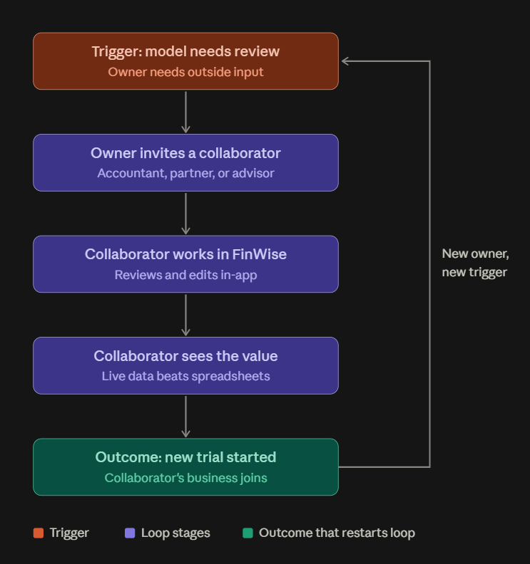

# The Bet · FinWise

> Module 1 · Ignite a PLG Motion. The growth hypothesis and where you're betting, plus the growth-loop visualization.

## Growth hypothesis

FinWise's biggest growth problem is an inability to monetize activated users, evidenced by a trial-to-paid conversion rate stubbornly frozen at ~2% (1.87–2.08%, mean 1.99% over 13 months) even when core feature engagement (like financial modeling, spiking to ~58%) surges, because a B2B financial tool for small businesses cannot be justified in a "single-player" vacuum at a premium subscription price. The true buying trigger and long-term retention hook rely on multiplayer collaboration—specifically, the business owner actively working with their accountant, bookkeeper, or partner inside the shared workspace.

_Earlier draft (superseded): I first framed this as a failure in early user activation and value delivery — friction reaching core value in the reverse trial, 60% annual paid churn (40% retained at 1 yr), stalling paid acquisition. The M4 data refined this: activation happens (import ~45%, modeling spikes to ~58%) but conversion never moves, so the gap is monetization of activated solo users, not failure to activate._

_____

## The bet

The highest-leverage experiment I'd run first is injecting a seamless "Invite Your Accountant/Advisor" collaboration trigger immediately after a user completes a financial model, testing whether multiplayer trial workspaces yield a statistically significant lift in paid conversions compared to single-player workspaces.

**Not doing:** I am deliberately not running top-of-funnel acquisition campaigns or single-player UI onboarding optimizations. The trade-off is accepting a potential bottleneck in total trial volume and individual feature discovery in order to hyper-focus engineering resources on generating a smaller, but highly qualified, cohort of collaborative workspaces that actually cross the monetization finish line.

_____

## Growth loop

**Loop type:** Collaboration.** Because FinWise is a B2B financial management tool, building features that encourage users to invite their bookkeeper, accountant, or business partner directly into the workspace naturally pulls in high-intent users. Since 98% of solo trial users are failing to see enough value to pay, a collaboration loop injects multiplayer utility into the product, which is highly effective at pushing B2B users over the monetization finish line.

> Note: re-upload `01-bet-growth-loop.png` (export of the "Screenshot 2026-10-06 145520.png" already in `01-bet/`) if the image does not render — the prior inline base64 was corrupted in export.
